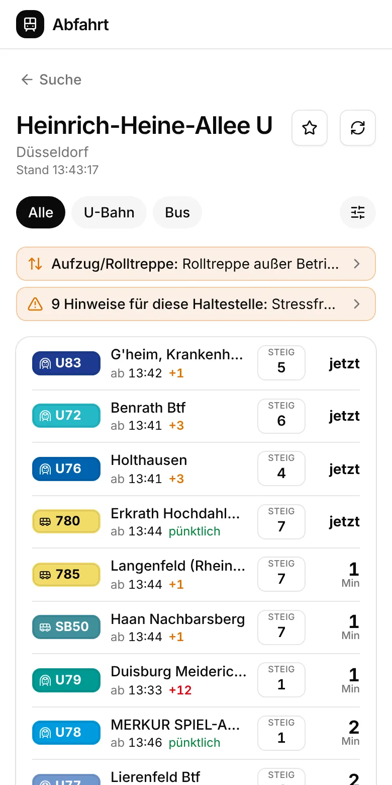
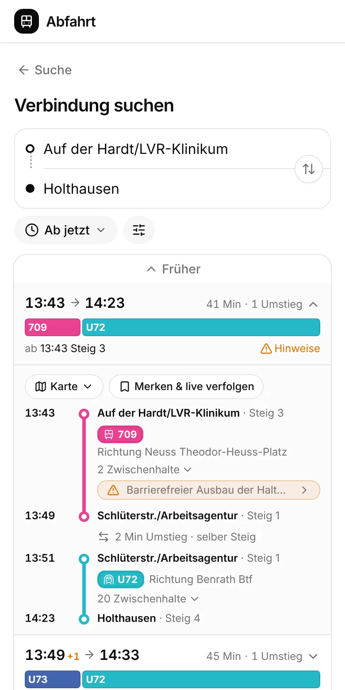
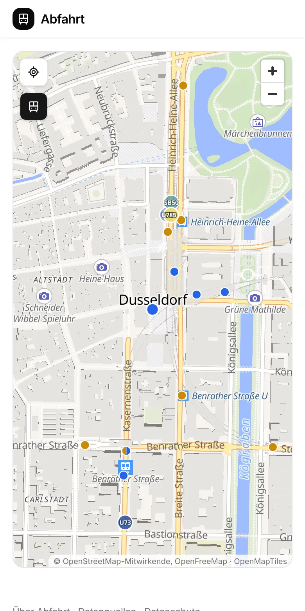

# Abfahrt

[](https://github.com/DasPocky/Abfahrt/actions/workflows/ci.yml)
[](LICENSE)

Echtzeit-Auskunft für Bus und Bahn als Progressive Web App: Abfahrten, Verbindungen, Karte mit Live-Fahrzeugen
und Störungen. Schwerpunkt Düsseldorf/Rheinland, nutzbar in ganz Deutschland. Läuft komplett im Free-Plan von
Cloudflare, ohne Konto und ohne Werbung.

**👉 Live: [abfahrt.endlab.de](https://abfahrt.endlab.de)**

<p align="center">
  
  
  
</p>

## Funktionen

- **Abfahrten** mit Echtzeit, Verspätung, Gleis/Steig, Ausfällen und Hinweisen; Filter nach Verkehrsmittel,
  Linie, Steig und Uhrzeit
- **Favoriten** mit eigenem Filter und Live-Abfahrten auf der Startseite
- **Haltestellen in der Nähe** und Suche mit Treffern in deiner Nähe zuerst
- **Verbindungssuche** von Haltestellen, Adressen und Orten, mit allen Optionen des VRR (Route, Verkehrsmittel,
  Umstiege, Zwischenhalt, Barrierefreiheit, Fahrrad); bevorzugt bequeme Umstiege am selben Steig
- **Live-Begleitung** einer gemerkten Verbindung mit Warnung bei gefährdetem Anschluss
- **Karte** mit jedem Steig an seiner echten Position und **Live-Fahrzeugen**
- **Störungen**, Aufzüge und Rolltreppen, mit Hinweis bei deinen Favoriten
- **Benachrichtigungen** (Web Push) bei Störungen und Änderungen deiner gemerkten Fahrt
- **Installierbar** auf iPhone und Android im Vollbild, funktioniert offline mit dem letzten Stand, hell und dunkel
  im EndLab-Look wie alle EndLab-Apps

Wie alles im Detail funktioniert: [Bedienung](docs/06-bedienung.md).

## Datenquellen

Abfahrt nutzt mehrere Quellen und nimmt je Region die beste. Fällt eine aus, springt die nächste ein.

| Quelle                                                                                            | Wofür                                                     |
| ------------------------------------------------------------------------------------------------- | --------------------------------------------------------- |
| [VRR OpenService](https://www.opendata-oepnv.de)                                                  | Abfahrten, Verbindungen, Störungen im VRR (sekundengenau) |
| [EFA-BW](https://www.mobidata-bw.de) (NVBW, MobiData BW)                                          | Abfahrten mit Echtzeit in Baden-Württemberg               |
| [Transitous](https://transitous.org)                                                              | ganz Deutschland, Karte, Live-Fahrzeuge, Linienfarben     |
| [OpenFreeMap](https://openfreemap.org) / [OpenStreetMap](https://www.openstreetmap.org/copyright) | Kartenkacheln                                             |

Wie gut die Echtzeit deutschlandweit abgedeckt ist und welche regionalen Quellen dazukommen sollen:
[Echtzeit-Abdeckung](docs/05-echtzeit-abdeckung.md). Alle Quellen mit Nutzungsbedingungen:
[Datenquellen](docs/01-datenquellen.md). Fahrplanauskünfte werden durch die Lizenzgeber zur Verfügung gestellt,
alle Angaben ohne Gewähr.

## Technik

- **App:** React, TypeScript, Vite, Tailwind, TanStack Query, MapLibre
- **Server:** ein Cloudflare Worker (API, Cache, Rate-Limit, Security-Header) mit Static Assets; D1 und
  Cron-Trigger für Push
- **Qualität:** Vitest (App und Worker), oxlint mit Typprüfung, Prettier, CodeQL, Dependabot

Aufbau und Entscheidungen: [Architektur](docs/02-architektur.md).

## Entwicklung

Voraussetzung: Node.js ≥ 26 (siehe `.nvmrc`).

```sh
npm ci              # Abhängigkeiten installieren (ohne Installationsskripte)
npm run dev         # App und Worker lokal starten (http://localhost:5173/)
npm test            # Tests für App und Worker
npm run lint        # oxlint + Prettier
npm run typecheck   # TypeScript
npm run build       # Produktions-Build
```

Deploy läuft über Cloudflare Workers Builds: jeder Zweig bekommt eine eigene Vorschau mit eigener
Push-Datenbank, ein Merge auf `main` geht in Produktion. GitHub Actions prüfen nur. Secrets (Push-Schlüssel)
liegen nur als Worker-Secret, nie im Repo und nie in GitHub. Details: [Workflow & Sicherheit](docs/04-workflow-sicherheit.md).

```text
src/        App (Seiten, Komponenten, reine Logik in src/lib)
worker/     Cloudflare Worker (API, Quellen-Adapter, Push)
shared/     Typen und Logik für App und Worker
test/       Worker-Tests mit aufgezeichneten Antworten der Quellen
docs/       Konzept, Datenquellen, Architektur, Workflow, Bedienung
```

## Mitmachen

Ablauf, Regeln und Commit-Stil: [CONTRIBUTING.md](CONTRIBUTING.md).
Sicherheitslücken bitte vertraulich melden: [SECURITY.md](SECURITY.md).

## Lizenz

[AGPL-3.0](LICENSE). Abfahrt ist ein privates Hobbyprojekt ohne Gewähr und ohne Verbindung zu den
Verkehrsunternehmen.
